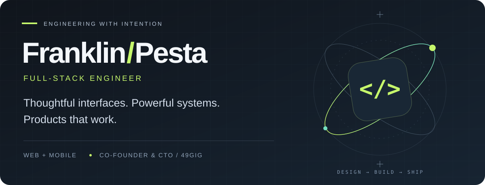

  

  
  
  

 

## A little about the builder

I'm **Franklin**, also known as **Pesta** — a full-stack engineer building production web and mobile applications. I care about the details people feel: a clear interface, a fast interaction, a reliable checkout, and a system that holds everything together.

I’m the **co-founder & CTO of [49GIG](https://49gig.com)**, a freelance marketplace connecting African talent with global clients. My work spans product interfaces, backend systems, mobile experiences, and end-to-end payment integrations.

**Open to contract work and collaborations.** Have a product in mind? [Let’s talk ↗](mailto:franklinolisaemeka3@gmail.com)

 

## Selected work

<table>
  <tr>
    <td width="50%" valign="top">
      <h3>01 / 49GIG</h3>
      
A freelance marketplace connecting African talent with global clients.

      
<strong>Co-founder & CTO · Next.js · Convex</strong>

      
<a href="https://49gig.com">Explore the product ↗</a> &nbsp; / &nbsp; <a href="https://github.com/Frankpesta/49gig">Source code</a>

    </td>
    <td width="50%" valign="top">
      <h3>02 / Pesta Ticketr</h3>
      
A ticketing platform built with the Nigerian market in mind.

      
<strong>Ticketing · TypeScript</strong>

      
<a href="https://pesta-ticketr.vercel.app/">Explore the product ↗</a> &nbsp; / &nbsp; <a href="https://github.com/Frankpesta/ticketing">Source code</a>

    </td>
  </tr>
  <tr>
    <td width="50%" valign="top">
      <h3>03 / My portfolio</h3>
      
A closer look at my work, the products I build, and how to reach me.

      
<strong>Projects · Craft · Contact</strong>

      
<a href="https://pesta-portfolio.vercel.app">Meet the builder ↗</a>

    </td>
    <td width="50%" valign="top">
      <h3>04 / The workshop</h3>
      
More applications, experiments, and ideas across my public repositories.

      
<strong>Web · Mobile · TypeScript</strong>

      
<a href="https://github.com/Frankpesta?tab=repositories">Explore the repositories ↗</a>

    </td>
  </tr>
</table>

 

## My toolkit

| Layer | Tools I work with |
| :--- | :--- |
| **Interfaces** | Next.js · React · TypeScript · Tailwind CSS · shadcn/ui · Framer Motion |
| **Mobile & desktop** | React Native · Expo · Electron |
| **Backend & data** | Node.js · NestJS · Laravel · Convex |
| **Product infrastructure** | Clerk · Resend · Vercel · Zustand |
| **Payments** | Paystack · Flutterwave · Stripe |

 

## How I build

**Start with the experience.** Make the journey clear and the interface deliberate.

**Connect the whole product.** Bring the frontend, backend, authentication, and payments together.

**Sweat the details.** Give interactions, responsiveness, and everyday usability the attention they deserve.

 

  
<strong>GitHub activity & language breakdown</strong>

   
  

    
    
  

  
<a href="https://github.com/Frankpesta?tab=repositories">Explore the repositories behind the numbers ↗</a>

 

---

<strong>Have an ambitious idea? Let’s make it real.</strong>

<a href="mailto:franklinolisaemeka3@gmail.com">franklinolisaemeka3@gmail.com</a> &nbsp; · &nbsp; <a href="https://pesta-portfolio.vercel.app">Portfolio</a> &nbsp; · &nbsp; <a href="https://49gig.com">49GIG</a>

Built with intention. — Pesta

